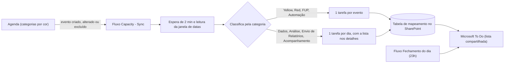

# Governança de Capacity e Visibilidade de Foco

Automação em **Power Automate** que transforma a agenda (Outlook/Teams) em uma lista do **Microsoft To Do** compartilhada com a gestão, para mostrar onde o tempo da equipe está sendo investido.

**Status:** em uso desde out/2026
**Ferramentas:** Power Automate (fluxos automatizado e agendado), Outlook/Teams (agenda e categorias), Microsoft To Do, SharePoint Lists

---

## Necessidade inicial

A gestão acompanha as demandas pelo Microsoft To Do, mas havia quatro problemas:

- O To Do trata do mesmo jeito uma tarefa de 15 minutos e uma de 4 horas, então a **carga real de trabalho não era visível**.
- A rotina ficava em **dois lugares** (agenda e To Do), e parte do trabalho existia só em um deles.
- Não havia **visão de tempo individual por tipo de atividade** (demandas da área, alinhamentos com outras áreas, backoffice de dados, análises e acompanhamentos).
- Manter os dois lugares atualizados dependia de **retrabalho manual**.

## Solução proposta

A agenda passa a ser a **única fonte**: cada evento recebe uma categoria (cor) e um fluxo mantém o To Do espelhado, sem digitação.

### Regras de conversão

| Categoria na agenda | Emoji no To Do | Tarefa gerada |
|---|---|---|
| Yellow (demandas da área) | 🟡 | 1 por evento |
| Red (alinhamentos com outras áreas) | 🔴 | 1 por evento |
| FUP | 🟤 | 1 por evento |
| Automação | 🤖 | 1 por evento |
| Dados (backoffice de dados) | 🔵 | 1 por dia, com a soma das durações |
| Análise (backoffice de análises) | 🟢 | 1 por dia, com a soma das durações |
| Envio de Relatórios | 🛑 | 1 por dia, com a soma das durações |
| Acompanhamento (eventos sem categoria, aceitos ou organizados por mim) | 🟣 | 1 por dia, com a soma das durações |

Convites não respondidos ou provisórios, recusados e cancelados **não viram tarefa**.

### Decisões de projeto

- **Tabela de mapeamento (SharePoint):** liga cada evento à sua tarefa. É ela que permite **atualizar e cancelar** sem criar duplicatas.
- **Duração no título:** tarefas individuais seguem o formato `[1h30] Assunto`. Nas diárias, o título traz o total e os eventos ficam listados nos detalhes (o conector do To Do usado não cria subitens).
- **Janela de datas dinâmica:** o fluxo lê o mês corrente e o seguinte, no fuso horário local.
- **Uma execução por vez:** o gatilho tem controle de concorrência igual a 1 para evitar tarefas duplicadas, com espera de 2 minutos para agrupar alterações seguidas.
- **Fechamento do dia:** um segundo fluxo, agendado para as 23h, conclui as tarefas de ontem e de hoje.

## Resultado

- **Agenda e To Do passam a mostrar o mesmo trabalho.** Criar, alterar ou excluir um evento atualiza a tarefa em poucos minutos, sem ação manual.
- **A gestão ganhou visão de carga por categoria e por dia**, com a duração no título e os emojis facilitando a leitura da lista.
- **O fluxo é seguro para reexecução:** rodar de novo não duplica tarefas, e eventos cancelados removem a tarefa correspondente.
- **A lista se fecha sozinha:** as tarefas de cada dia são concluídas à noite, e a lista principal mostra só o que vem pela frente.
- **A tabela de mapeamento já guarda categoria, data e duração**, uma base pronta para análises de horas por categoria.

### Limitações de licença e uso dos recursos disponíveis

O projeto foi desenhado para caber nas licenças que já existem, sem pedir ferramentas adicionais:

- **Somente conectores padrão** (Outlook, To Do, SharePoint e operações de dados do próprio Power Automate), sem conectores premium.
- **SharePoint Lists no lugar de um banco de dados.** A tabela de mapeamento cumpre o papel de banco, sem custo extra.
- **Sem subitens no To Do.** O conector não oferece essa ação; a solução foi agrupar eventos de backoffice em uma tarefa por dia, com a lista nos detalhes.
- **Acesso limitado no Power BI.** Não é possível compartilhar relatórios, o que pesou na escolha de manter os dados em uma lista e priorizar uma visão simples antes de um painel.
- **Planner sem controle de horas no plano básico.** O campo de esforço exige licença adicional, por isso ele ficou como alternativa a avaliar, e não como base da solução.
- **Limite de requisições e fila de execuções.** O controle de concorrência igual a 1 e a espera de 2 minutos mantêm o fluxo dentro do que a licença permite, ao custo de algum atraso.

### Aprendizados e limitações

- O conector do To Do não oferece subitens; a lista de eventos do dia ficou nos detalhes da tarefa.
- Cada alteração de evento gera uma execução, e muitas alterações seguidas formam fila. Para edições em massa, vale pausar o fluxo e religá-lo ao final.
- A sessão do aplicativo do To Do no desktop pode expirar e parar de sincronizar; a causa não é o fluxo, e o navegador serve de conferência.
- Expressões do Power Automate exigem cuidado com acentos nos nomes das categorias e com colagem duplicada de fórmulas.

### Próximos passos

- **Painel de horas por categoria**, sem trabalho manual além de manter a agenda. A tabela de mapeamento já guarda categoria, data e duração; a primeira opção a testar é uma visão agrupada da própria lista, com soma das durações, e, se for preciso mais, Excel ou Power BI. O Microsoft Planner foi considerado, mas o plano básico não tem campo de horas e ele não lê a agenda sozinho: seria preciso um fluxo para criar as tarefas lá.
- **Otimizar o fluxo** para gravar no To Do apenas o que de fato mudou, reduzindo o tempo de cada execução.