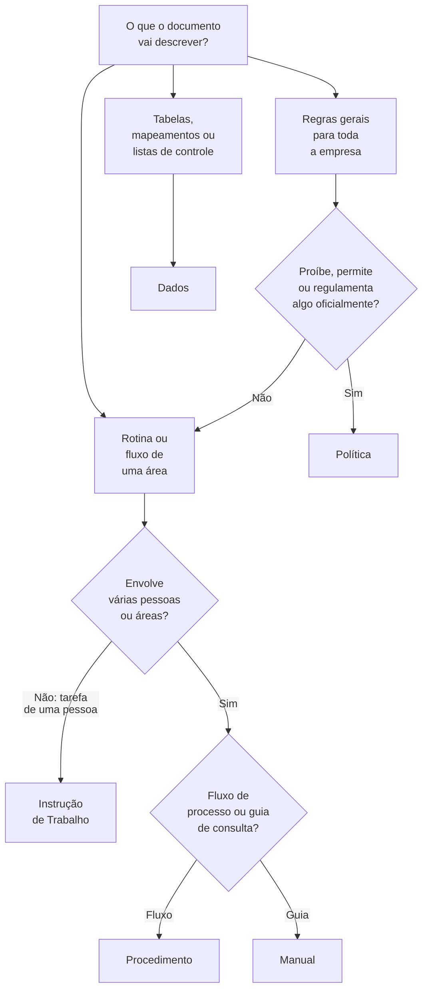
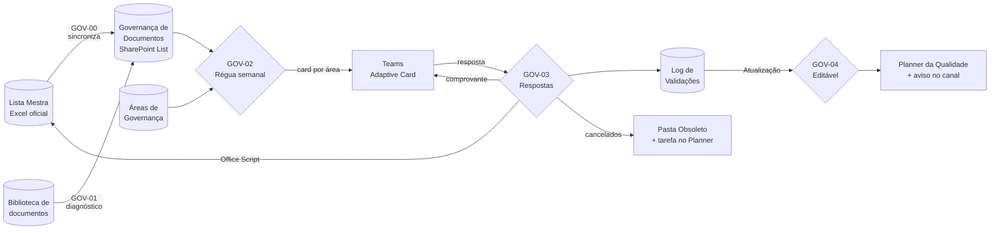

# Governança ISO e Régua de Comunicação por Lote

Automação do **ciclo de vida dos documentos da Lista Mestra**: da solicitação de um documento novo ou de uma revisão até a validação periódica pelo gestor de cada área. Tudo integrado ao Microsoft 365, com tarefas claras para a equipe da Qualidade e evidências prontas para auditoria.

O projeto foi construído em duas fases:

| Fase | Foco | Status |
|---|---|---|
| **1. Portal de solicitações** | Formulários e fluxos para criação, revisão e entrega de documentos, gerando tarefas no Planner. | Em uso |
| **2. Régua de validação por lote** | Validação periódica dos documentos pelos gestores, por cards interativos no Teams. | Em construção (testes com áreas-piloto) |

> **Ferramentas:** Power Automate, Microsoft Forms, Microsoft Planner, Microsoft Teams (Adaptive Cards), SharePoint Lists, Excel Online + Office Scripts.

---

## Fase 1: Portal de solicitações de documentos

### Necessidade

As solicitações de documentos (novos documentos, pedidos de editáveis para revisão e entrega de documentos atualizados) eram feitas por um formulário na intranet que abria um ticket na ferramenta de atendimento. Três problemas foram mapeados:

1. **A Qualidade deixou de ser notificada.** Áreas que não atuam diretamente no atendimento ao cliente passaram a ter licenças restritas na ferramenta de tickets, e esse tipo de usuário não recebe notificações. As novas solicitações chegavam sem que ninguém fosse avisado.
2. **Documentos criados no modelo errado.** Os modelos editáveis (com cabeçalho, rodapé e índice padronizados) ficavam disponíveis, mas quem criava um documento nem sempre sabia se precisava de uma política, um procedimento ou uma instrução de trabalho. Era comum, por exemplo, uma instrução de trabalho ser escrita no modelo de política.
3. **Muitas conferências manuais.** Cada documento recebido exige várias verificações antes de ir para aprovação, e elas dependiam da memória de quem revisava.

### Solução

Três formulários no **Microsoft Forms**, publicados como botões na página de Políticas e Procedimentos da intranet, cada um com o seu fluxo no **Power Automate**:

| Formulário | O que o usuário informa | O que o fluxo faz |
|---|---|---|
| **Elaboração de Novo Documento** | Área e respostas a perguntas simples sobre a rotina | Identifica o **tipo de documento** adequado, entrega o link do modelo correto, cria a tarefa no Planner e avisa a Qualidade no Teams. |
| **Solicitação de Documento Editável** | Código e nome do documento, o que será alterado e o gestor que aprovará | Cria a tarefa de envio do editável no Planner e avisa a Qualidade no Teams. |
| **Envio de Documento Revisado** | Código do documento e o arquivo editável revisado | Cria a tarefa de revisão no Planner, com o checklist de conferência, e avisa a Qualidade no Teams. |

**Árvore de decisão do tipo de documento.** Em vez de pedir que o usuário escolha o tipo, o formulário faz perguntas sobre a rotina e chega ao modelo certo:



Antes de liberar o modelo, o formulário orienta o usuário a verificar se já existe um documento daquele tipo para a área, evitando duplicidades.

**Planner como quadro de trabalho.** As tarefas caem em buckets que representam as etapas do ciclo do documento:

```
Novos documentos sendo criados ─┐
                                ├─► Revisão dos documentos enviados ─► Em aprovação ─► Finalizados
Envio de editáveis solicitado ─► Elaboração (editável disponibilizado) ─┘
```

Cada tarefa já nasce com **descrição e checklist** do que a analista precisa conferir. Por exemplo, no recebimento de um documento revisado: preenchimento de cabeçalho e rodapé, número do documento e da revisão, sumário atualizado, registro da alteração no quadro de revisões, geração do PDF com o título padrão, envio para o fluxo de aprovação e atualização da Lista Mestra e da intranet.

### Resultado

- A Qualidade voltou a ser **notificada de toda solicitação**, por mensagem no canal da equipe e tarefa no Planner, independentemente de licenças da ferramenta de tickets.
- Os documentos novos passaram a nascer **no modelo correto**, com a classificação feita a partir da rotina descrita pelo próprio usuário.
- As conferências ficaram **padronizadas**: o checklist acompanha cada tarefa, e o trabalho da equipe ficou visível por etapa.

---

## Fase 2: Régua de validação por lote

### Necessidade

A Lista Mestra é o registro oficial dos documentos da organização. Manter esses documentos alinhados à prática depende de o gestor de cada área confirmar, periodicamente, que eles continuam válidos.

No modelo anterior:

- a cobrança era **manual e pontual**, por e-mail e mensagens;
- não havia **alerta preventivo**: muitas revisões só eram pedidas depois do vencimento;
- as respostas dos gestores preciavam ser acompanhadas e salvas manualmente na pasta de evidências de aprovação;
- documentos de processos descontinuados continuavam na lista, e processos alterados na prática corriam o risco de não estarem atualizados no papel.

O objetivo é passar de um modelo **reativo** (cobrança) para um modelo **proativo e automatizado**, alinhado às boas práticas de controle de informação documentada (ISO 9001, item 7.5.3) e de análise crítica.

### Visão geral



### Componentes

| Componente | Tipo | Papel |
|---|---|---|
| Lista Mestra | Excel (tabela) | Registro oficial homologado. Recebe a nova data de validação e o status de cancelamento. |
| Governança de Documentos | SharePoint List | Espelho operacional da Lista Mestra, com caminho e link de cada arquivo, situação do padrão e última decisão do gestor. |
| Áreas de Governança | SharePoint List | Uma linha por área: aprovador, substituto e controle da campanha (status, tipo, nº de avisos, datas). |
| Log de Validações | SharePoint List | Evidência auditável de cada decisão: documento, decisão, aprovador, data e hora, justificativa e campanha. |
| Planner da Qualidade | Planner | O mesmo quadro da Fase 1, com buckets novos para documentos cancelados e áreas sem resposta. |

### Fluxos

| Fluxo | Gatilho | O que faz |
|---|---|---|
| **GOV-00 Sincronização** | Agendado (semanal) | Copia datas, status e revisão da Lista Mestra para a lista de governança e inclui códigos novos. |
| **GOV-01 Diagnóstico** | Manual / agendado | Localiza o arquivo de cada documento pelo código, grava caminho e link, liga o documento à sua área e aponta desvios de padrão (código fora do padrão, arquivo não encontrado, fora da pasta padrão). |
| **GOV-02 Régua semanal** | Agendado (semanal) | Para cada área com aprovador, decide se abre campanha, envia o card no Teams, controla os lembretes e escala para o Planner quando não há resposta. |
| **GOV-03 Respostas do gestor** | Resposta ao card | Valida o card, aplica as decisões na Lista Mestra (via Office Script) e na lista de governança, grava o log, trata cancelamentos, fecha a campanha e envia o comprovante. |
| **GOV-04 Editável solicitado** | Novo item no Log | Reaproveita a lógica do fluxo de solicitação de editáveis da Fase 1: para cada pedido de atualização feito no card, cria a tarefa no Planner (sem duplicar) e avisa no canal da Qualidade. |

### Regras de negócio

**Campanhas por área.** Os documentos são agrupados por área e enviados ao aprovador cadastrado. Só entram na régua as áreas com aprovador, o que permite implantar a solução de forma gradual.

**Dois tipos de campanha.**

| Campanha | Documentos | Regra de abertura |
|---|---|---|
| **Normativos (NOR)** | Políticas e procedimentos | Abre assim que algum documento da área chega a 60 dias do vencimento. |
| **Operacionais (OPE)** | Demais tipos | Abre quando não há normativos na janela e já se passaram 6 meses desde a última campanha NOR da área. |

Cada documento continua sendo validado uma vez por ano, mas o gestor recebe dois lotes menores, e os normativos têm prioridade. Ao confirmar todos os documentos de uma vez, a área passa a ter um ciclo anual único.

**Régua de comunicação.** Aviso inicial em D-60 e lembretes semanais (D-53 e D-46). Sem resposta em D-39, o fluxo cria uma tarefa no bucket *Sem resposta do aprovador* e marca a área como *Escalada*, deixando 39 dias para a Qualidade agir antes do vencimento.

**As decisões do gestor (rotas do card).**

| Decisão | Resultado |
|---|---|
| Confirmar vigência | Renova a data de validação na Lista Mestra (+12 meses). |
| Solicitar atualização | O documento sai da régua até a nova revisão, e a tarefa de envio do editável é criada no Planner. |
| Cancelar documento | Status *Cancelado* na Lista Mestra, arquivos movidos para a pasta *Obsoleto* e tarefa para retirar o documento da intranet. |
| Novo documento | Botões de acesso aos formulários da Fase 1. |

**Proteções.**

- Cards grandes são divididos em partes de até 15 documentos (limite de tamanho do Teams).
- Um card de campanha encerrada ou substituída é tratado como **expirado**: nada é gravado e o gestor recebe um aviso.
- Enquanto a campanha está aberta, vale a **última resposta** de cada documento.
- O cancelamento é **definitivo** pelo fluxo; reversões ficam com a Qualidade.
- Pedidos de atualização repetidos não geram tarefas duplicadas.
- Todo envio gera um **Comprovante de Validação Documental** no chat do gestor.

### Resultado esperado

- Fim da cobrança manual: os alertas chegam de forma preventiva, no Teams, 60 dias antes do vencimento.
- O gestor da área assume a responsabilidade pela validade dos seus documentos, com poucos cliques.
- **Rastreabilidade**: cada decisão fica registrada com data, hora, aprovador e justificativa, servindo de evidência de análise crítica periódica em auditorias.
- Base documental mais fiel à prática: documentos descontinuados são cancelados e processos alterados entram em revisão.
- Escalabilidade: a base pode crescer sem aumento proporcional de esforço da equipe da Qualidade.

**Indicadores previstos:** % de documentos validados no prazo via Teams e % de documentos obsoletos identificados.

---

## Aprendizados técnicos

- **Nomes internos de colunas do SharePoint.** Colunas criadas a partir do Excel recebem nomes como `field_8`, e acentos viram códigos (`ã` → `_x00e3_`). Quando o nome interno começa com `_`, o conector acrescenta o prefixo `OData_` (por exemplo, `OData__x00da_ltimadecis_x00e3_o`). Sem isso, a expressão retorna vazio sem dar erro.
- **Fuso horário.** Gravar uma data `yyyy-MM-dd` numa coluna do SharePoint grava meia-noite UTC, que aparece como o dia anterior no horário de Brasília. A solução foi converter com `convertToUtc(..., 'E. South America Standard Time')` antes de gravar e com `convertFromUtc` antes de comparar.
- **Normalização de textos.** Espaços invisíveis (`CHAR(160)`) e espaços no fim dos nomes quebravam comparações; o fluxo normaliza tudo com `trim`, `replace` e `toLower` antes de comparar.
- **Lista Mestra com várias linhas por código** (versões em outros idiomas): a ação padrão do Excel só altera a primeira linha encontrada, por isso a gravação é feita por um [Office Script](scripts/GOV_AtualizaListaMestra.ts) que atualiza todas.
- **Gatilho de resposta a Adaptive Card** só funciona no editor clássico do Power Automate e, depois de alterado, exige desligar e religar o fluxo para registrar a inscrição.
- **Atualizar o card no chat de outra pessoa** retorna `403 AclCheckFailed`, porque a conta do fluxo não participa da conversa entre o gestor e o bot. O comprovante passou a ser enviado como um novo card.
- **Respostas simultâneas** (várias partes enviadas em sequência) fazem execuções paralelas lerem dados desatualizados. O gatilho de respostas passou a processar uma resposta por vez (controle de concorrência = 1).

## Próximos passos

- Concluir os testes com áreas-piloto e migrar para a Lista Mestra oficial.
- Card de confirmação para cancelamentos sem justificativa.
- Lembretes contendo apenas os documentos ainda pendentes.
- Preenchimento automático dos aprovadores a partir da base de RH.
- Vigência diferenciada por tipo de documento.
- Migrar os fluxos para uma conta de serviço.